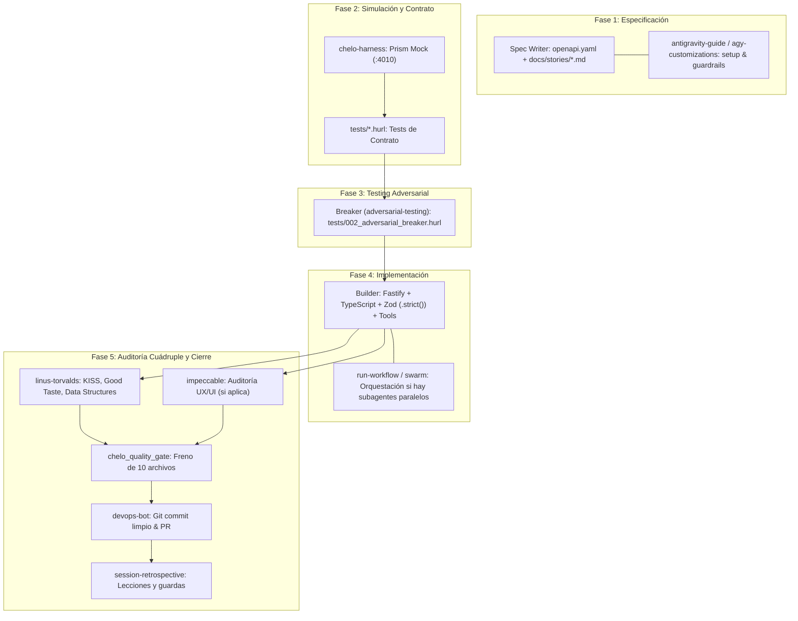

# Reglas de Gobernanza Chelo-Harness (Spec-First) - edi3-ai-production

Este repositorio implementa el proyecto integrador de Inteligencia Artificial para EDI 3 (TECDA 3º año), cubriendo:
1. **Prompt Engineering & Structured Outputs:** Clasificación y extracción tipada en esquemas estrictos (Zod).
2. **Function Calling & Tool Use:** Consumo de herramientas seguras tipadas en lugar de texto libre del LLM.
3. **RAG & Embeddings:** Ingestión dinámica de normativas por API sin hardcodear archivos, chunking y recuperación bajo aislamiento multitenant.
4. **Seguridad Defensiva en LLMs:** Delimitación de datos, sanitización, prevención de inyecciones y principio de mínimo privilegio en herramientas.
5. **Resiliencia & Producción:** Timeouts obligatorios, rate limiting, presupuestos diarios, observabilidad (trazas/tokens) y tests de contrato automatizados.

---

## 1. Principio Sagrado: Metodología Spec-First
- La **única fuente de verdad** del sistema es [`openapi.yaml`](file:///home/jmro/Documents/Development/edi3-ai-production/openapi.yaml).
- No se escribe código de backend sin antes tener definidos los esquemas de entrada/salida y contratos HTTP.
- Cada endpoint debe validarse mediante pruebas Hurl (`tests/*.hurl`) y levantarse previamente con Prism Mock Server (`chelo_mock_start`).

---

## 2. Invariantes Críticas de Seguridad e IA (Linus Torvalds + OWASP LLM)
- **Gobernanza de Tareas en GitHub (Issues & Milestones):**
  - **Requisito Previo Obligatorio:** Antes de comenzar cualquier tarea, funcionalidad o refactor, se debe registrar el Issue en GitHub y asignarlo al Milestone correspondiente.
  - **Trazabilidad de Commits:** Todo commit debe vincularse al Issue (ej. `feat(api): validación con Zod (resolves #1)`).
  - **Cierre Formal:** Al finalizar y pasar todos los tests (Hurl/Breaker), el Issue debe cerrarse formalmente y marcarse el avance en el Milestone.

- **Cero Confianza en Salidas de LLMs:** La salida del modelo es `untrusted input`. Jamás pasa a ejecución directa sin validación estricta con esquemas Zod.
- **Aislamiento Multitenant en BD:** Toda query de búsqueda vectorial debe incluir obligatoriamente el filtro relacional en el servidor (`WHERE tenant_id = :tenant_id`). Jamás se confía en el prompt para aislar datos.
- **Plano de Control vs. Datos:** El contenido externo (prompts de usuarios, WhatsApp, RAG) se encapsula en tags XML pasivos (`<patient_message>...</patient_message>`).
- **Resiliencia de Red:** Toda llamada a APIs de LLMs debe tener timeout configurado (máximo 30s) y reintentos con backoff exponencial y jitter únicamente sobre errores 429/5xx (nunca 400).
- **Invariante de Prescripción Cero:** Prohibido emitir nombres de fármacos, dosis o recetas automáticas por chat.
- **Consulta de Apuntes:** La fuente teórica son los apuntes Markdown en [`docs/study-guide/`](file:///home/jmro/Documents/Development/edi3-ai-production/docs/study-guide/); no se consultan PDFs pesados.

---

## 3. Matriz de Skills y Gobernanza de Agentes

| Skill | Rol en el Proyecto | Mandato Operativo |
| :--- | :--- | :--- |
| **`linus-torvalds`** | **Auditor de Código & Arquitectura** | KISS, estructuras de datos sólidas, eliminación de casos especiales, invariantes inquebrantables y cero tolerancia a la sobreingeniería o wrappers innecesarios. |
| **`adversarial-testing` (Breaker)** | **Auditor Adversarial & Fuzzing** | Romper el sistema antes de producción: Property-Based Testing (PBT), ataques de prompt injection (directos/indirectos), boundary cases y verificación de que el LLM no ejecute nada no autorizado. |
| **`chelo-harness`** | **Gobernanza Spec-First & Quality Gate** | Control de mock servers, validación OpenAPI, ejecución de tests Hurl y contención estricta de cambios (máximo 10 archivos por ticket). |
| **`session-retrospective`** | **Mejora Continua** | Audita decisiones tomadas durante el desarrollo para proponer guardas automáticas y prevenir regresiones o repetición de errores. |
| **`devops-bot`** | **Automatización Git & CI** | Control de versiones limpio, ramas aisladas, verificación de builds locales y preparación de PRs respetando límites de tokens. |
| **`impeccable`** | **Auditor UX/UI** | En caso de interfaces web o reportes visuales: diseño limpio, tipografía, jerarquía clara, accesibilidad y componentes robustos. |
| **`run-workflow` & `swarm` / `swarm_monitor`** | **Orquestación Paralela** | Ejecución de pipelines de agentes (Spec Writer $\to$ Builder $\to$ Auditores paralelos) cuando la tarea requiera separación de autoría o trabajo concurrente. |
| **`antigravity-guide` & `agy-customizations`** | **Referencia de Entorno** | Consulta y aplicación de directivas, variables de entorno y configuración nativa de Antigravity. |

---

## 4. Pipeline de Software Factory (Workflow de Desarrollo en 5 Fases)

Todo desarrollo de endpoint, feature o refactorización sigue obligatoriamente este workflow secuencial donde **cada herramienta tiene una fase y un control explícito**:

### Fase 1: Especificación y Contrato Formal (Spec Writer + `antigravity-guide`)
- Formalizar User Stories en `docs/stories/*.md` con criterios BDD (*Given / When / Then*).
- Escribir o actualizar el contrato en `openapi.yaml` declarando esquemas con `additionalProperties: false`.
- **`antigravity-guide` & `agy-customizations`:** Regulan las directivas del entorno, variables y aislamiento del workspace.

### Fase 2: Verificación de Contrato y Mocking (`chelo-harness`)
- **`chelo-harness`:** Levanta Prism Mock Server con `chelo_mock_start` en puerto `:4010`.
- Diseñar y ejecutar tests Hurl de contrato (`tests/*.hurl`) contra el mock para validar el consumo del cliente antes de codificar.

### Fase 3: Testing Adversarial (`adversarial-testing` - Breaker)
- El subagente **Breaker** audita la especificación antes de programar la lógica.
- Diseña ataques de prompt injection, fuzzing de payloads (`\0`, strings gigantes), cross-tenant tampering y evasión clínica.
- Registra la suite en `tests/002_adversarial_breaker.hurl` y el reporte en `docs/BREAKER_REPORT.md`.

### Fase 4: Implementación Segura (Builder + `run-workflow` / `swarm`)
- Arquitectura desacoplada en TypeScript (Fastify + Zod).
- **Validación en la frontera:** Middleware Zod `.strict()` descartando cualquier payload malformado antes de invocar el LLM.
- **Function Calling / Tools:** La IA no responde texto libre; invoca herramientas tipadas (`consultar_disponibilidad`, `consultar_aranceles`, `consultar_normativa_rag`, `solicitar_reserva`).
- **Contexto Vivo:** Consume datos de MySQL en `clinicContext` en vez de quemar aranceles o feriados en prompts fijos.
- **RAG Dinámico por API:** Almacenamiento vectorial en SQLite (`sqlite-vec`) filtrado estrictamente por `tenantId`.
- **`run-workflow` & `swarm` / `swarm_monitor`:** Si una tarea requiere paralelismo de subagentes (ej. indexación masiva o autorías separadas), se orquesta mediante el swarm coordinado.

### Fase 5: Auditoría Cuádruple en Paralelo y Quality Gate
1. **Auditoría de Código y Arquitectura (`linus-torvalds`):**  
   Revisión estricta de estructuras de datos, eliminación de casos especiales, KISS, ausencia de sobreingeniería y respeto irrestricto de invariantes ("Never break userspace").
2. **Auditoría de Interfaz y Experiencia (`impeccable`):**  
   Si el ticket incluye vistas frontend, dashboards o reportes: accesibilidad, contraste, consistencia de tokens de diseño y legibilidad clínica.
3. **Freno de Seguridad y Calidad (`chelo_quality_gate`):**  
   Verificación automática de que la suite Hurl esté verde y no se hayan modificado más de 10 archivos.
4. **Automatización y Control de Versiones (`devops-bot`):**  
   Commits atómicos bajo convenciones, verificación de ramas y preparación de Pull Requests con consumo eficiente de tokens.
5. **Retrospectiva y Aprendizaje Continuo (`session-retrospective`):**  
   Auditoría de la sesión, captura de correcciones del usuario y generación de reglas defensivas permanentes en `AGENTS.md`.
