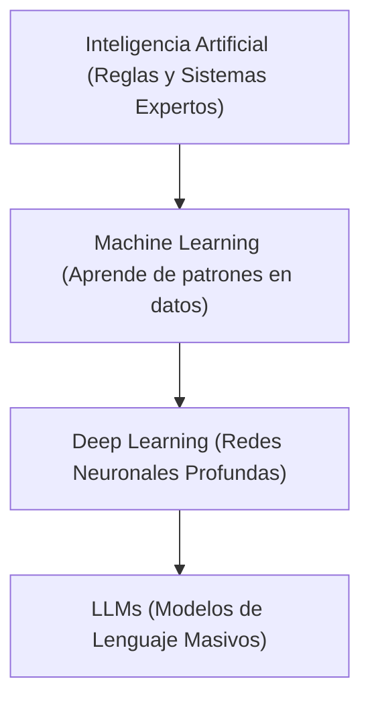

# Apuntes: Capítulo 01 · Fundamentos de Inteligencia Artificial
> **Curso:** Curso Inicial de IA para Desarrolladores (EDI 3 - TECDA 3º)  
> **Documento fuente:** [`TERCERO/EDI_3/01. Fundamentos de Inteligencia Artificial.pptx`](file:///home/jmro/Documents/Academy/TECDA/TERCERO/EDI_3/01.%20Fundamentos%20de%20Inteligencia%20Artificial.pptx)  
> **Práctica asociada:** [`TERCERO/EDI_3/01_practica_busqueda_literal_vs_semantica.ipynb`](file:///home/jmro/Documents/Academy/TECDA/TERCERO/EDI_3/01_practica_busqueda_literal_vs_semantica.ipynb)

---

## 1. ¿Qué es Inteligencia Artificial?

La **IA** es la rama de las ciencias de la computación dedicada a diseñar y construir sistemas capaces de resolver tareas que comúnmente requieren inteligencia humana, tales como:
- Razonamiento y deducción lógica.
- Percepción sensorial (visión, procesamiento de audio y lenguaje).
- Toma de decisiones y resolución de problemas.

---

## 2. Niveles de Abstracción: IA vs. Machine Learning vs. Deep Learning



* **IA Tradicional (Simbólica / Basada en Reglas):**  
  Programación manual explícita (árboles de decisión, reglas condicionales `if/else`). No aprende de la experiencia ni de nuevos datos.
* **Machine Learning (Aprendizaje Automático):**  
  Algoritmos estadísticos que identifican patrones en datos para predecir o clasificar sin ser programados paso a paso para cada caso.
* **Deep Learning (Aprendizaje Profundo):**  
  Subcampo de ML basado en redes neuronales con múltiples capas ocultas (arquitecturas profundas), capaz de procesar automáticamente datos no estructurados masivos (imágenes, audio, texto en bruto).

---

## 3. Conceptos Clave: Algoritmo vs. Modelo

* **El Algoritmo (El proceso / El método de estudio):**  
  Conjunto de instrucciones matemáticas de optimización (ej. descenso de gradiente, retropropagación) que analiza los datos de entrenamiento para medir errores y calibrar pesos.
* **El Modelo (El artefacto / El estudiante preparado):**  
  Representación matemática resultante con los parámetros y pesos sinápticos congelados. Es el archivo ejecutable final que recibe una entrada (*input*) y genera una inferencia/predicción (*output*).

---

## 4. Ciclo Operativo: Entrenamiento vs. Inferencia

| Dimensión | 1. Entrenamiento (*Training*) | 2. Inferencia (*Inference*) |
| :--- | :--- | :--- |
| **Objetivo** | Crear y calibrar el modelo optimizando sus pesos | Usar el modelo ya entrenado para responder |
| **Cómputo** | Masivo (Clusters de GPUs/TPUs, días o semanas) | Ligero y optimizado para baja latencia (tiempo real) |
| **Datos** | Datasets colosales (terabytes/petabytes) | Una entrada puntual (prompt, imagen, audio) |
| **Ejemplo** | Entrenar un clasificador con millones de fotos | Subir una foto y detectar si contiene un objeto |

---

## 5. Paradigmas de Aprendizaje

1. **Aprendizaje Supervisado:**  
   - Trabaja con pares **$(X, Y)$** (datos de entrada etiquetados con su respuesta correcta).  
   - *Casos de uso:* Clasificación de spam, diagnóstico médico por imágenes, regresión de precios inmobiliarios.
2. **Aprendizaje No Supervisado:**  
   - Trabaja solo con datos de entrada **$X$** sin etiquetas previas; el sistema descubre estructura intrínseca, clústeres o anomalías.  
   - *Casos de uso:* Segmentación de clientes, agrupamiento de tópicos, detección de fraudes bancarios.

---

## 6. Redes Neuronales y LLMs

### 6.1 Redes Neuronales y Mecanismos de Representación
Inspiradas matemáticamente (no biológicamente) en grafos ponderados dirigidos. Cada conexión posee un **peso** ($w$) y un término de sesgo ($b$). Conforme los tensores atraviesan capas sucesivas, la red aplica transformaciones lineales seguidas de funciones de activación no lineales.

> [!IMPORTANT]
> **Distinción de Arquitecturas (KISS & Rigor Técnico):**  
> No confundir modelos convolucionales (CNN) con Transformers:
> - En **Visión por Computadora (CNNs)**, las capas jerárquicas extraen características espaciales locales (*bordes $\to$ texturas $\to$ formas $\to$ objetos*).
> - En **Modelos de Lenguaje (Transformers)**, no hay filtros convolucionales locales; las capas calculan **proyecciones de atención contextual dinámica (*Self-Attention*)**, ponderando matemáticamente cómo se relaciona cada token con todos los demás a lo largo de toda la secuencia.

### 6.2 ¿Qué es un Large Language Model (LLM)?
Un LLM es una red neuronal Transformer autoregresiva entrenada con miles de millones de tokens mediante aprendizaje autosupervisado (*Next-Token Prediction*).
> **Mecanismo nuclear:** En su base, un LLM es un **predictor estadístico del siguiente token**. Dada una secuencia $[t_1, t_2, \dots, t_n]$, calcula la distribución de probabilidad para predecir $t_{n+1}$. No "comprende" hechos ni posee conciencia; ajusta superficies de probabilidad multidimensionales.

---

## 7. Capacidades vs. Limitaciones de los LLMs

### Capacidades
- **Generación y Síntesis:** Redacción de artículos, resumen de documentos técnicos extensos, extracción estructurada.
- **Traducción y Transferencia de Estilo:** Conversión entre idiomas naturales y cambio de registro (técnico, divulgativo, ejecutivo).
- **Ingeniería de Software:** Asistencia en generación de código, debugging, refactorización y explicación de scripts.
- **Razonamiento en Contexto (*In-Context Learning*):** Capacidad de seguir instrucciones y resolver casos lógicos a partir de los datos provistos en el prompt.

### Limitaciones
- **Alucinaciones:** Generación de información falsa o inexistente articulada con absoluta convicción.
- **Falta de comprensión real:** Manipulación sintáctica de tokens sin anclaje en el mundo físico ni conciencia causal.
- **Sesgos inherentes:** Reflejo de sesgos culturales, temporales o de representatividad presentes en los datos de entrenamiento.
- **Ventana de Contexto finita:** Capacidad máxima de memoria por llamada (límite de tokens en la conversación activa).

---

## 8. Flujo de Arquitectura Básica de Consumo

```
[ Usuario ]
    │
    ▼
[ Aplicación Cliente / Frontend ]
    │
    ▼
[ API de IA / Orquestador Backend ]
    │
    ▼
[ Modelo LLM (Inferencia) ]
    │
    ▼
[ Respuesta al Usuario ]
```
