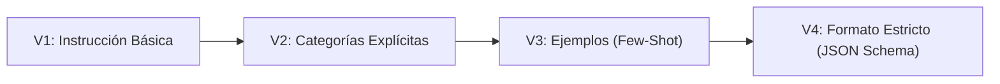

# Apuntes: Capítulo 03 · Prompt Engineering y Clasificación de Textos
> **Curso:** Curso Inicial de IA para Desarrolladores (EDI 3 - TECDA 3º)  
> **Documentos fuente:** [`TERCERO/EDI_3/03 - Curso_IA_Prompt_Engineering.pdf`](file:///home/jmro/Documents/Academy/TECDA/TERCERO/EDI_3/03%20-%20Curso_IA_Prompt_Engineering.pdf) / [`03 - Prompt_Engineering.pptx`](file:///home/jmro/Documents/Academy/TECDA/TERCERO/EDI_3/03%20-%20Prompt_Engineering.pptx)  
> **Eje temático:** Técnicas de Prompting, Zero-Shot vs. Few-Shot, mitigación de ambigüedad, salidas estructuradas (JSON) y diseño de clasificadores.

---

## 1. Fundamentos: Clasificación con LLMs vs. Reglas Tradicionales

### El límite de la programación clásica:
```python
# Enfoque frágil por palabras clave
if "comprar" in mensaje:
    return "VENTA"
elif "error" in mensaje:
    return "SOPORTE"
```
* **Problema:** En lenguaje natural, la sintaxis engaña:  
  *"Desde ayer intento comprar una vacuna pero la página me tira error"* contiene ambas palabras, pero la **intención dominante** es un problema técnico bloqueante (`SOPORTE`), no una intención comercial pura.
* **El enfoque LLM:** Evalúa el contexto semántico completo de la oración para inferir la intención real del usuario.

---

## 2. Técnicas de Prompting: Zero-Shot vs. Few-Shot

### 2.1 Zero-Shot Prompting
Se solicita la clasificación directa sin proporcionar ejemplos previos.
```text
Clasificá el siguiente mensaje como VENTA, SOPORTE o CONSULTA:
"Necesito comprar una vacuna."
```
* *Ventaja:* Mínimo consumo de tokens de entrada.
* *Riesgo:* Mayor dispersión en formatos de respuesta y dificultad en límites ambiguos.

### 2.2 Few-Shot Prompting (In-Context Learning)
Se acondiciona al modelo mostrándole pares de entrada y salida demostrativos antes de presentarle el caso a resolver.
```text
Clasificá el mensaje como VENTA, SOPORTE o CONSULTA.

Ejemplos:
- "Quiero comprar 20 dosis" -> VENTA
- "El sistema no me permite ingresar" -> SOPORTE
- "¿Qué dosis corresponde?" -> CONSULTA

Mensaje a clasificar:
"Necesito comprar una vacuna."
```
* *Beneficios clave:*
  - Alinea el estilo y formato exacto esperado.
  - Resuelve sutilezas de dominio o casos borde específicos.
  - Reduce drásticamente la tasa de alucinación o respuestas verbosas innecesarias.

---

## 3. El Impacto Crucial del Contexto y Casos Ambiguos

El significado de un término cambia radicalmente según las palabras circundantes:
- *"El auto es gris"* $\to$ **Neutro** (descripción física objetiva).
- *"Es un día gris"* $\to$ **Negativo** (connotación emocional / meteorológica triste).
- *"Me encanta el color gris"* $\to$ **Positivo** (expresión de preferencia).

### Gestión de Ambigüedad:
1. **Definiciones taxativas de categorías:** Una categoría mal definida crea inconsistencia estocástica.
2. **Categoría de escape (`OTRO` o `AMBIGUO`):** Evita que el modelo fuerce clasificaciones erróneas cuando el mensaje carece de datos suficientes.
3. **Puntuación de Confianza:** Solicitar al modelo que cuantifique su nivel de certeza (0.0 a 1.0).

---

## 4. Evolución hacia Prompts Robustos (Niveles de Madurez)



* **V1:** `"Clasificá: No puedo ingresar"` $\to$ Respuesta impredecible, explicaciones no deseadas.
* **V2:** `"Clasificá entre [VENTA, SOPORTE, CONSULTA]: No puedo ingresar"` $\to$ Limita el espacio de clases.
* **V3:** Incorpora 2 ejemplos por categoría aclarando distinciones sutiles.
* **V4:** Impone formato estructurado y regla de no verborrea.

---

## 5. Salidas Estructuradas: JSON Predictible para APIs

Para integrar un LLM en un backend tradicional, la respuesta no puede ser texto libre. Debe exigirse un objeto JSON parseable:

```json
{
  "categoria": "SOPORTE",
  "confianza": 0.95,
  "motivo": "El usuario reporta un fallo de autenticación al intentar acceder a la plataforma."
}
```

### Reglas para asegurar JSON válido:
1. Especificar el esquema en el prompt (o usar APIs con *Structured Outputs* / *JSON mode*).
2. Prohibir delimitadores Markdown adicionales (` ```json `) si el parser espera un flujo crudo.
3. Incluir el campo `motivo` para que el modelo razone antes de emitir la clase (*Chain of Thought implícito*).

---

## 6. Guía de Trabajos Prácticos del Capítulo

* **TP 1:** Clasificación de sentimientos (Positivo, Negativo, Neutro) y análisis de ambigüedad (*"No está mal"*).
* **TP 2:** Clasificación de intenciones de negocio (VENTA, SOPORTE, CONSULTA, PRECIO).
* **TP 3:** Polisemia contextual (análisis del término *"gris"*).
* **TP 4:** Comparativa experimental Zero-Shot vs. Few-Shot.
* **TP 5:** Estructura canónica de un prompt industrial (Objetivo + Categorías + Descripciones + Ejemplos + Instrucción de cierre).
* **TP 6:** Iteración y refinamiento de prompts en 4 versiones.
* **TP 7:** Análisis de casos límite e inconsistencia en intenciones mixtas.
* **TP 8:** Generación de salidas tipadas en JSON con atributos `categoria`, `confianza` y `motivo`.
* **TP 9:** Construcción y testeo de un dataset sintético/manual de 30 mensajes con ruido, errores tipográficos y jerga informal.
* **TP 10 (Proyecto Integrador):** Microservicio clasificador de atención al cliente con JSON estricto y categoría fallback `OTRO`.
