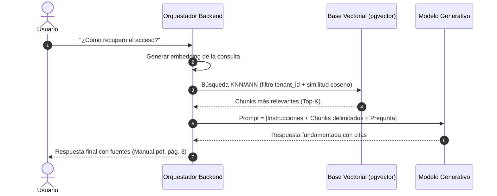

# Apuntes: Capítulo 04 · RAG y Embeddings (Retrieval-Augmented Generation)
> **Curso:** Curso Inicial de IA para Desarrolladores (EDI 3 - TECDA 3º)  
> **Documentos fuente:** [`TERCERO/EDI_3/04 - Practicas_RAG_y_Embeddings.pdf`](file:///home/jmro/Documents/Academy/TECDA/TERCERO/EDI_3/04%20-%20Practicas_RAG_y_Embeddings.pdf) / [`04 - RAG_y_Embeddings.pptx`](file:///home/jmro/Documents/Academy/TECDA/TERCERO/EDI_3/04%20-%20RAG_y_Embeddings.pptx)  
> **Eje temático:** Arquitectura RAG, pipelines de ingestión, estrategias de chunking, bases vectoriales (PostgreSQL + pgvector), evaluación y diagnóstico de fallos.

---

## 1. ¿Qué es RAG y por qué no es Fine-Tuning?

* **El problema del LLM estándar:** Conocimiento congelado en su fecha de corte (*cut-off*), desconocimiento de datos privados corporativos y tendencia a alucinar ante lagunas de información.
* **Fine-Tuning:** Modifica los pesos del modelo para cambiar su estilo, tono o comportamiento sintáctico; **no** es eficiente ni confiable para inyectar conocimiento fáctico dinámico o auditable.
* **RAG (Generación Aumentada por Recuperación):** Mantiene el modelo congelado y le suministra como contexto documental en tiempo real la información exacta necesaria para responder.



---

## 2. Ingestión y Estrategias de Chunking

Para que un documento pueda recuperarse sin diluir la señal ni perder coherencia, debe dividirse estratégicamente:

| Estrategia | Ventajas | Desventajas / Riesgos |
| :--- | :--- | :--- |
| **Por Encabezados / Estructural** | Preserva la unidad temática y la coherencia lógica de la sección | Falla si el documento carece de estructura o tiene secciones kilométricas |
| **Por Tamaño Fijo (Tokens/Palabras)** | Predictible y fácil de paralelizar | Puede cortar una instrucción o fórmula matemática por la mitad |
| **Ventana Deslizante con Solapamiento (*Overlap*)** | Garantiza que las ideas en los bordes de corte no se pierdan (ej. 300 tokens con 50 tokens de solapamiento) | Duplica ligeramente el almacenamiento vectorial |

---

## 3. Almacenamiento Vectorial: Esquema en PostgreSQL (`pgvector`)

Un fragmento nunca se almacena como un vector huérfano. Requiere metadatos estrictos para auditoría, control de acceso y citación:

```sql
CREATE EXTENSION IF NOT EXISTS vector;

CREATE TABLE fragmentos (
    id UUID PRIMARY KEY DEFAULT gen_random_uuid(),
    cliente_id VARCHAR(64) NOT NULL,            -- Aislamiento multitenant
    documento_id VARCHAR(128) NOT NULL,
    nombre_documento VARCHAR(255) NOT NULL,
    pagina_origen INT,
    contenido TEXT NOT NULL,                     -- Texto original del chunk
    embedding vector(384) NOT NULL,             -- Dimensión según el modelo (ej. all-MiniLM-L6-v2)
    modelo_version VARCHAR(64) NOT NULL,        -- Versionado del modelo de embeddings
    creado_en TIMESTAMP WITH TIME ZONE DEFAULT NOW()
);

-- Índice aproximado para búsquedas ultrarrápidas
CREATE INDEX ON fragmentos USING hnsw (embedding vector_cosine_ops);
```

> [!WARNING]
> **Realidad de Base de Datos (Índices HNSW vs. Filtros Relacionales):**  
> En PostgreSQL con `pgvector`, ejecutar `WHERE cliente_id = :cliente_id ORDER BY embedding <=> :embedding_consulta` sobre un índice HNSW global puede degradar seriamente el rendimiento si un cliente tiene pocos registros respecto al total (post-filtering sobre el grafo).  
> **Criterio de Buen Gusto:** Para entornos multitenant masivos reales:
> 1. Si los tenants son grandes: particionar la tabla por `cliente_id` con un índice HNSW por partición.
> 2. Si son millones de micro-tenants: evaluar índices `ivfflat` o índices compuestos btree/vector según el volumen de datos.

### Consulta de Recuperación Segura:
```sql
SELECT id, contenido, nombre_documento, pagina_origen,
       (embedding <=> :embedding_consulta) AS distancia
FROM fragmentos
WHERE cliente_id = :cliente_id                  -- FILTRO OBLIGATORIO DE SEGURIDAD
ORDER BY distancia ASC
LIMIT 5;
```
> **Nota técnica:** En `pgvector`, el operador `<=>` calcula la **distancia coseno** ($1 - \text{similitud}$). Por eso se ordena de menor a mayor (`ASC`).

---

## 4. Diagnóstico y Taxonomía de Fallos en Sistemas RAG

| Código | Síntoma en Producción | Diagnóstico / Causa Raíz | Mitigación Inmediata |
| :---: | :--- | :--- | :--- |
| **Caso A** | El documento existe, pero nunca aparece en los resultados | Fallo en la etapa de **Recuperación**: chunking inadecuado, embedding de mala calidad, $K$ muy bajo o error en filtros SQL | Ajustar tamaño de chunk, probar búsqueda híbrida (Dense + BM25) o subir $Top\text{-}K$ |
| **Caso B** | Se recuperan los chunks correctos, pero la respuesta los contradice | Fallo de **Generación / Síntesis**: prompt confuso, atención dispersa o modelo pequeño desalineado | Reforzar el System Prompt: *"Responde basándote EXCLUSIVAMENTE en el contexto provisto"* |
| **Caso C** | Respuesta correcta, pero cita una página equivocada | Desfase en **Metadatos**: mapeo erróneo durante el parseo del PDF | Corregir el extractor OCR / PDF para vincular cada chunk con su número de página real |
| **Caso D** | Una consulta devuelve datos de otro cliente | **Falla crítica de Seguridad / Fuga de datos**: falta de filtro `tenant_id` en el backend | Forzar el filtro de autorización en la cláusula `WHERE` del servidor, jamás delegar la seguridad al LLM |
| **Caso E** | Pregunta sin respuesta en los documentos recibe respuesta inventada | **Alucinación por falta de evidencia**: umbral de distancia nulo | Establecer un umbral de distancia máxima y ordenar: *"Si el contexto no lo dice, responde que no dispones de información"* |

---

## 5. Métricas de Evaluación Sistemática

Para evaluar si un pipeline RAG funciona en producción:
1. **Recall@K:** Porcentaje de preguntas de prueba donde el fragmento que contiene la verdad terrenal (*Ground Truth*) aparece dentro de los primeros $K$ resultados recuperados.
2. **Fidelidad (*Faithfulness*):** Proporción de afirmaciones generadas por el modelo que pueden ser deducidas y respaldadas directamente por los fragmentos recuperados.
3. **Relevancia de la Respuesta:** Medición de si la respuesta generada aborda de forma directa y concisa la pregunta del usuario.

---

## 6. Checklist de Implementación del Mini Chatbot Documental

- [ ] Extracción y preservación estricta de metadatos (`documento`, `página`, `chunk_index`).
- [ ] Chunks de 250-400 tokens con 15% de overlap.
- [ ] Modelo de embeddings consistente (ej. `all-MiniLM-L6-v2` o `text-embedding-3-small`).
- [ ] Base vectorial con soporte de distancias (Coseno) e índices vectoriales (HNSW/IVFFlat).
- [ ] Filtro estricto multitenant (`cliente_id`) en cada consulta.
- [ ] Prompt con delimitación estricta de contexto (`<contexto>...</contexto>`).
- [ ] Manejo explícito de respuestas fuera de contexto / evidencia insuficiente.
- [ ] Formato de respuesta con citas verificables a documentos de origen.
